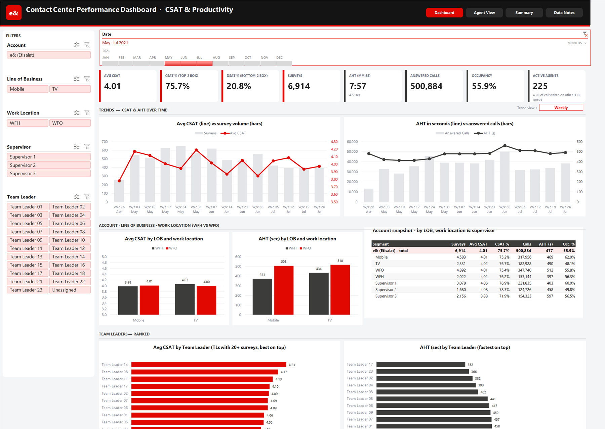
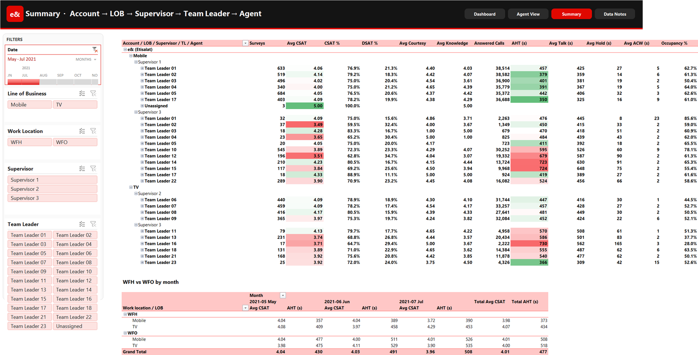
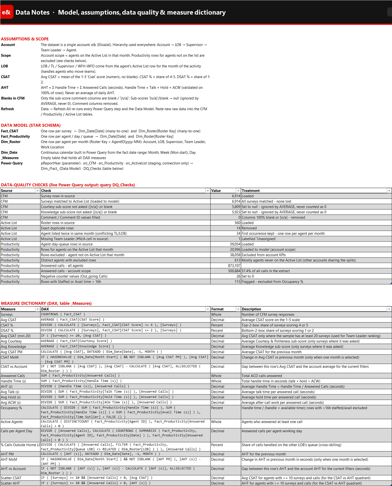
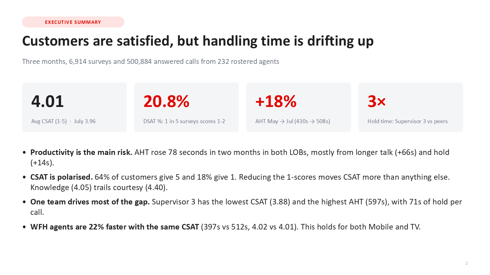
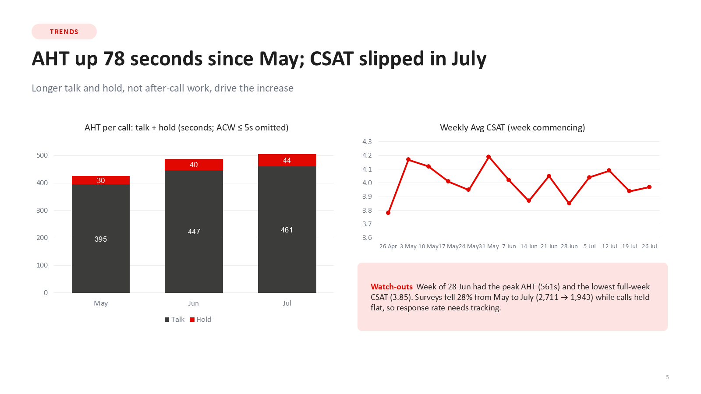
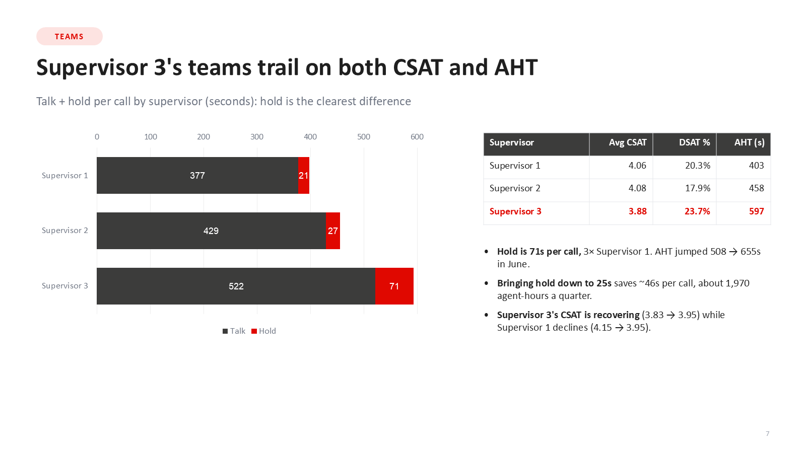
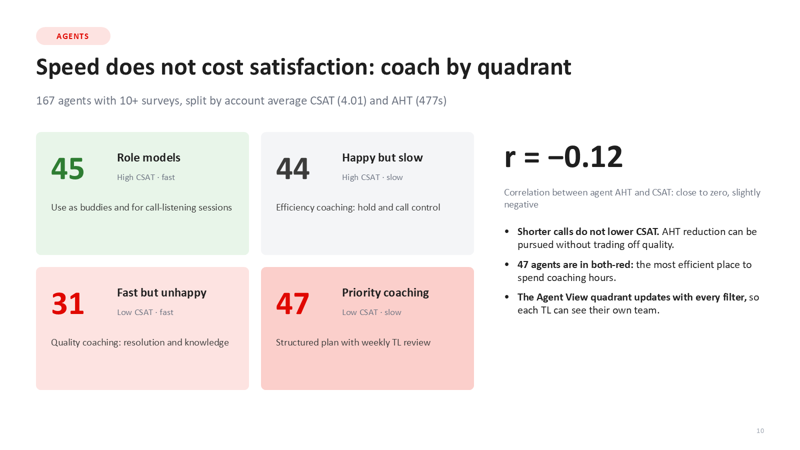

# e& Contact Center: CSAT & Productivity Dashboard

An Excel dashboard and findings deck built as an **MIS Specialist assessment** for e& (Etisalat) inbound customer support (Mobile and TV, May to July 2021). One refreshable model (Power Query, star schema, DAX) feeds a four-page dashboard on customer satisfaction and agent productivity.



## Headline numbers

| Avg CSAT | CSAT % (4-5) | DSAT % (1-2) | AHT | Answered calls | Surveys |
|---|---|---|---|---|---|
| 4.01 | 75.7% | 20.8% | 7:57 | 500,884 | 6,914 |

## What the analysis found

- **Handling time is drifting up.** AHT rose 18% from May to July (430s to 508s) in both lines of business, mostly from longer talk (+66s) and hold (+14s).
- **CSAT is polarised.** 64% of customers give a 5 and 18% give a 1. Moving half the 1-scores to 4 would lift Avg CSAT from 4.01 to about 4.28. Knowledge (4.05) trails courtesy (4.40).
- **One supervisor's teams trail on both measures.** Lowest CSAT (3.88), highest AHT (597s) and 71s of hold per call, about three times that of the other supervisors.
- **WFH agents are 22% faster with the same CSAT** (397s vs 512s, 4.02 vs 4.01), in both lines of business. Caveat: 53 WFH vs 193 WFO agents, so tenure should be checked before scaling.
- **Speed does not cost satisfaction.** The correlation between agent AHT and CSAT is r = -0.12, so agents were split into four coaching quadrants (45 role models, 44 happy but slow, 31 fast but unhappy, 47 priority coaching).

## Five actions recommended for the next 90 days

1. Cut hold time in the weakest supervisor's teams (about 1,970 agent-hours a quarter).
2. Attack the 1-scores with a daily DSAT callback list and root-cause tagging (DSAT 20.8% to 15%).
3. Product-knowledge refreshers to close the 0.35 gap between knowledge and courtesy.
4. Coach by quadrant: pair role models with priority-coaching agents.
5. Fix the data foundation: confirm roster completeness, one row per agent per month.

## How it is built

```
Raw sheets (CFM, Productivity, Active List)
  -> Power Query: src_ staging queries (types, #N/A -> null, [n/a] -> null, negatives -> 0, outlier flag)
  -> Star schema: Fact_CSAT, Fact_Productivity -> Dim_Date, Dim_Roster (agent x month)
  -> 25 DAX measures (Avg CSAT, CSAT %, AHT = sum(handle) / sum(calls), MoM, vs-account gaps)
  -> Dashboard: slicers + timeline, CUBEVALUE KPI cards, pivot charts, drill-down
```

**Four pages, one set of filters:** Dashboard, Agent View (leaderboard and CSAT vs AHT quadrant), Summary (drill-down Account > LOB > Supervisor > Team Leader > Agent) and Data Notes (assumptions, star-schema map, live data-quality checks, DAX dictionary).

**Data-quality decisions** (all counts are produced live by a `DQ_Checks` query):

- Account scope = agents on the Active List that month; 43% of answered calls came from agents not on the list and were excluded from account KPIs.
- 14 exact duplicate and 34 conflicting roster rows resolved to one row per agent per month.
- Sub-scores that were not asked are null, never 0, so averages are not understated.
- 115 productivity rows with more than 16 staffed hours in a day are flagged and excluded from Occupancy only.

## Screenshots

| | |
|---|---|
|  |  |
|  |  |
|  |  |

## Repository contents

- [`presentation/`](presentation) - the 12-slide findings deck (PowerPoint)
- [`docs/measure-dictionary.md`](docs/measure-dictionary.md) - all 25 DAX measures with formulas and descriptions
- [`screenshots/`](screenshots) - dashboard pages and key slides

## A note on the data

The Excel workbook is not published here because it holds agent-level operational data from the assessment. The screenshots and deck show aggregated results with anonymised labels (Supervisor 1-3, Team Leader 01-23).

---

Built by [Omar Moussa](https://omarmoussa724.github.io) | [LinkedIn](https://www.linkedin.com/in/omar-moussa-a9121523b)
